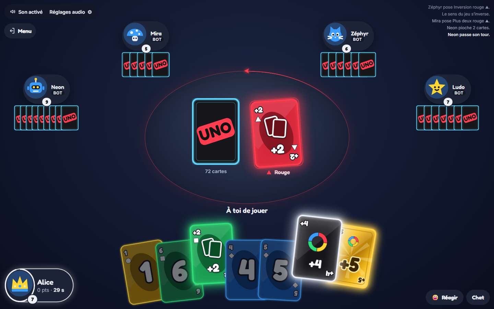
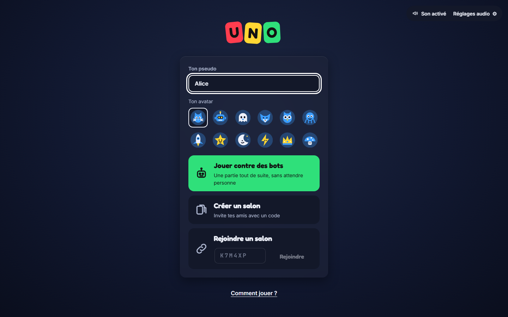
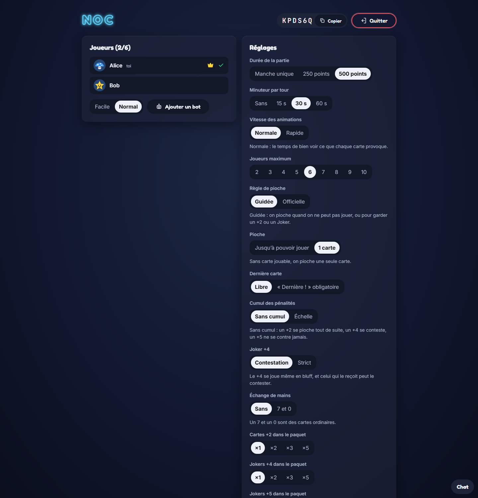
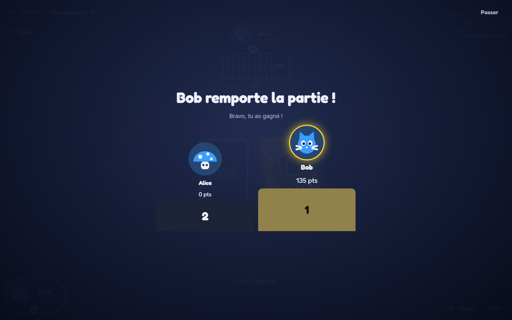
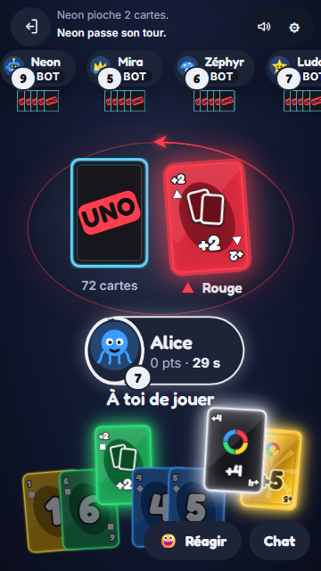
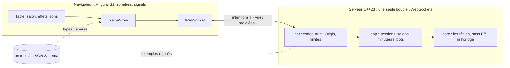

# NOC

NOC est un jeu de défausse inspiré des jeux de cartes classiques, multijoueur en ligne, **dans le navigateur, sans compte ni installation** : on choisit un pseudo, on crée un
salon, on partage un code de 6 caractères, et on joue de 2 à 10, avec ou sans bots.



| Accueil | Salon |
|---|---|
|  |  |
| **Fin de partie** | **Sur téléphone** |
|  |  |

## Ce que le jeu sait faire

- **Les règles de base** : toutes les cartes, la contestation du Joker +4, le « Contre ! » (avec grâce et échéance),
  le sens du jeu, le remélange de la défausse, le score sur 250 ou 500 points ou une manche unique.
- **Des règles maison, réglées par l'hôte** (toutes désactivées par défaut, expliquées dans la page « Comment jouer ») :
  pioche guidée ou « jusqu'à pouvoir jouer », « Dernière ! » obligatoire pour gagner, cumul des pénalités à l'échelle
  (+2 < +4 < +5), Joker +4 strict, échange des mains avec les 7 et les 0, Joker +5 « super carte », paquet plus ou
  moins riche en cartes spéciales, minuteur de tour, vitesse des animations.
- **Des bots** de deux niveaux, qui ne voient que ce qu'un joueur voit.
- **Une vraie table** : adversaires disposés autour d'une ellipse, éventails, cartes qui volent de la pioche et vers la
  défausse, effets pour chaque carte, cinématique d'ouverture et de fin de partie, sons et musique **générés** par le
  navigateur (aucun fichier audio).
- **Du social léger** : avatars, chat (texte brut), six réactions rapides, exclusion par l'hôte, revanche.
- **Partout** : de 360 à 1920 px, en portrait et en paysage, au clavier seul, au lecteur d'écran, en mouvement réduit.
- **Entre amis, depuis son PC** : un script lance le jeu et un tunnel, pour jouer à distance sans serveur loué
  ([mode d'emploi](docs/MODE-EMPLOI.md)).

## Architecture



Le principe qui structure tout : **le serveur est la seule autorité**. Le navigateur envoie des *intentions* (« je
pose cette carte »), le serveur valide tout (tour, possession, légalité, phase) et ne renvoie à chacun que **sa
projection** de la partie : jamais les mains des autres, l'ordre de la pioche ni la graine aléatoire. Un test
automatisé le vérifie, à chaque coup d'une simulation de milliers de parties.

## Choix techniques

| Choix | Pourquoi | Décision |
|---|---|---|
| Règles dans une bibliothèque **pure** (`core`) | Aucune dépendance réseau, horloge ou aléa global : tout est injecté, donc testable et rejouable à l'identique | [0010](docs/adr/0010-round-state.md), [0008](docs/adr/0008-portable-deterministic-randomness.md) |
| `std::variant` + `std::visit` pour actions, phases, événements | Un ensemble fermé : le compilateur refuse un cas oublié | [0006](docs/adr/0006-variant-closed-sets.md) |
| Erreurs métier en `std::expected`, pas en exceptions | Une action refusée est un cas normal, et elle ne change rien à l'état | [0006](docs/adr/0006-variant-closed-sets.md) |
| Protocole décrit en **JSON Schema** | Une source de vérité : les types du client sont générés, les exemples rejoués des deux côtés | [0005](docs/adr/0005-json-schema-protocol.md), [0007](docs/adr/0007-protocol-v1-deviations.md) |
| Projection des vues **et des événements** | Aucun secret ne sort, même par une animation ou un événement | [0013](docs/adr/0013-player-view-projection.md), [0015](docs/adr/0015-event-projection.md) |
| Le serveur dicte le rythme (`actionsOpenAt`) | Personne ne joue avant que la table ait montré ce qui vient de se passer | [0026](docs/adr/0026-paced-draw.md), [0027](docs/adr/0027-effect-resolution.md) |
| Animations pilotées par les **événements**, jamais par une comparaison de vues | Cosmétiques et rejouables ; une reconnexion affiche l'état final | [0022](docs/adr/0022-event-driven-animations.md) |
| Bots sur la seule `PlayerView` | Ils ne peuvent pas tricher, et le moteur n'a aucun cas particulier | [0030](docs/adr/0030-bots.md) |
| Session en cookie `HttpOnly`, un seul onglet actif, plafonds | Le jeton n'est jamais lisible par un script ; un visiteur ne peut pas épuiser le serveur | [0036](docs/adr/0036-session-cookie.md) |
| Sons **synthétisés** (Web Audio) | Aucun fichier, aucun droit à régler, des sons qui suivent les effets | [0031](docs/adr/0031-intro-and-sound.md), [0032](docs/adr/0032-music-ui-sounds-and-dust.md) |
| Jouer par un tunnel Cloudflare depuis son PC | Du jeu à distance sans hébergement, avec contrôles de sécurité avant publication | [0033](docs/adr/0033-play-through-a-tunnel.md) |
| Options maison : `jumpIn` **retiré**, +4 strict et 7-0 ajoutés | Une règle qui contredit le rythme du jeu n'a pas sa place ; les autres sont testées à fond | [0040](docs/adr/0040-no-jump-in.md), [0041](docs/adr/0041-strict-wild-draw-four-and-seven-zero.md) |

Les 41 décisions sont dans [docs/adr/](docs/adr/), et la [spécification](docs/SPEC.md) dit le quoi et le pourquoi.

## Qualité

- **Plus de 500 tests C++** (Catch2) dont une **simulation massive** : des milliers de parties à actions légales et
  hostiles mêlées, avec les invariants du moteur et l'anti-fuite vérifiés après chaque coup.
- **Plus de 450 tests client** (Vitest) et **plus de 90 scénarios de bout en bout** (Playwright), jouant de vraies
  parties à deux navigateurs, sur téléphone émulé, au clavier seul, avec axe (WCAG 2.2 AA et bonnes pratiques).
- **Intégration continue** sous Linux (GCC et Clang, sanitizers ASan et UBSan, clang-tidy) et sous Windows (MSVC),
  actions épinglées, audit des dépendances.
- **Accessibilité et performance** mesurées : Lighthouse 100 en accessibilité et en bonnes pratiques, 100 en
  performance sur ordinateur (98 sur mobile).
- **Sécurité** : tout message reçu est hostile (taille, schéma strict, type inconnu rejeté, limites par connexion et par
  adresse, `Origin` vérifiée), jetons et codes tirés d'un générateur cryptographique, aucun secret dans le dépôt.
  Voir [SECURITY.md](SECURITY.md).

## Comment jouer

La page **« Comment jouer »** (lien sur l'accueil) explique les règles, les cartes spéciales, le « Dernière ! » et le « Contre ! », et
chaque option du salon avec un exemple. En bref : poser une carte de la même couleur ou du même symbole, piocher sinon,
et annoncer « Dernière ! » à l'avant-dernière carte, sous peine d'être contré.

## Lancer le projet

Prérequis (Windows 10/11, Build Tools Visual Studio, CMake, Ninja, vcpkg, Node) : voir [docs/SETUP.md](docs/SETUP.md).

```powershell
# Depuis un terminal où l'environnement MSVC x64 est chargé (`dev64`, voir docs/SETUP.md)
cd server
cmake --preset dev
cmake --build --preset dev
cd ..
./scripts/dev.ps1        # lance le serveur (port 9001) et le client (http://localhost:4200)
```

Ouvrir deux navigateurs (ou une fenêtre privée) sur <http://localhost:4200> : un joueur crée un salon, l'autre le rejoint
par le code ou le lien. Deux onglets du même navigateur sont le même joueur (la session est un cookie).

Pour jouer avec des amis à distance : `./scripts/play-online.ps1` (voir le [mode d'emploi](docs/MODE-EMPLOI.md)).
Les tests et le lint (serveur, client, E2E) sont listés dans la section « Commandes » de [CLAUDE.md](CLAUDE.md).

## Arborescence

| Dossier | Contenu |
|---|---|
| `protocol/` | schémas du protocole (source de vérité) et exemples de messages |
| `server/` | serveur C++23 : `core` (règles, sans E/S), `app` (salons, sessions, minuteurs, bots), `net` (réseau), `bootstrap` |
| `client/` | application Angular |
| `e2e/` | tests de bout en bout Playwright |
| `deploy/` | Caddy pour le jeu par tunnel (Docker et déploiement permanent : phase 6, voir [l'avancement](docs/PROGRESS.md)) |
| `docs/` | spécification, avancement, décisions d'architecture (`adr/`), mode d'emploi |

## Documentation

- [Mode d'emploi pour l'hôte](docs/MODE-EMPLOI.md) : jouer avec des amis à distance, pas à pas.
- [Déploiement permanent](docs/DEPLOIEMENT.md) : mettre le jeu en ligne sur un serveur Coolify, clic par clic.
- [Spécification](docs/SPEC.md) : le quoi et le pourquoi de chaque choix.
- [Avancement](docs/PROGRESS.md) : phases, étapes, journal.
- [Décisions d'architecture](docs/adr/) : une ADR par choix structurant.
- [Sécurité](SECURITY.md) : comment signaler une faille.

## Contribuer

Projet personnel : les contributions externes ne sont pas attendues. Pour signaler une faille de sécurité, voir
[SECURITY.md](SECURITY.md).

## Licence

Tous droits réservés : pas de licence open source pour l'instant. Le code est public pour être lu, pas pour être
réutilisé.

## Crédits

Polices **Fredoka**, **Inter** et **JetBrains Mono**, sous licence [SIL Open Font License 1.1](https://openfontlicense.org),
installées via [Fontsource](https://fontsource.org) (`@fontsource-variable/fredoka`, `@fontsource-variable/inter`,
`@fontsource/jetbrains-mono`). Les cartes, le logo, les avatars et les icônes sont dessinés pour le projet.
